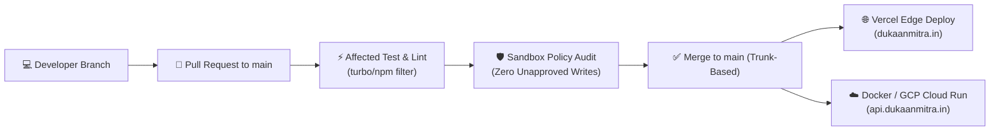

# 🏢 DukaanMitra AI Engineering — Company Operating Model & Production Architecture

> **Corporate Registry**: DukaanMitra Retail Technologies Private Limited (Bharat)
> **Master Monorepo**: `C:\Users\18\OneDrive\Desktop\Projects\DukaanMitra-OS`
> **Production Target**: `dukaanmitra.in` | **API**: `api.dukaanmitra.in` | **OpenWA**: `whatsapp.dukaanmitra.in` (:2785)

---

## 👥 1. Team Structure & Work Alignment (Pod-Based Organization)

Inside a unified monorepo, engineering teams are organized by **domain capability** rather than repository silos:

| Team / Pod | Scope & Responsibilities | Core Monorepo Ownership |
|---|---|---|
| **Platform & Platform-Ops Team** | Monorepo health, CI/CD speed (Turborepo), dependency versions, Vercel & Nginx ingress, shared tooling | `package.json`, `vercel.json`, `nginx/`, `infra/` |
| **AI Engine & Sandbox Team** | Core agent architectures, LLM prompts/RAG, Agent Development Kit (ADK), gVisor/Docker isolated runtimes | `apps/ai-services/`, `sdks/agent-development-kit/`, `packages/agent-mesh/` |
| **Product Feature Pods (Cross-Functional)** | Micro-frontends, Khata bookkeeping, billing POS, catalog management, customer storefront | `apps/mitra-os-web/`, `apps/dukaan-in-next/`, `apps/core-engine/` |
| **Security & Compliance Team** | Sandbox isolation boundaries, DPDP Act 2023 compliance, Maker-Checker proposal approval gates, audit trails | `packages/sandbox-governor/`, `apps/ai-services/sandbox/security/` |

---

## 🔄 2. Monorepo Workflow & Developer Lifecycle



- **Branching Strategy**: Trunk-Based Development. Feature branches live `< 48 hours`.
- **Targeted Testing**: Only modules with modified file hashes are tested and built.
- **Strict Codeownership**: `CODEOWNERS` mandates Security Lead approval for financial policy changes.

---

## 📂 3. Monorepo Directory Layout

```
DukaanMitra-OS/
├── apps/                          # Deployable Applications
│   ├── mitra-os-web/              # React/Vite Merchant Console & Landing (Vercel CDN)
│   ├── dukaan-in-next/            # Next.js 14 Hyperlocal Customer Storefront
│   ├── core-engine/               # Node.js/Prisma Distributed Event Engine (Port 3000)
│   ├── ai-services/               # Python FastAPI Superintelligence & Sandbox (Port 8000)
│   └── whatsapp-gateway/          # OpenWA Docker Container Gateway (Port 2785)
├── packages/                      # Shared Modules & Private Business Logic
│   ├── enterprise-agents/         # 20 Specialized Autonomous Domain Agents
│   └── agent-mesh/                # Router, Munim AI, Inventory AI, Growth/GMB AI
├── sdks/                          # Publicly Exposed Development Toolkits
│   ├── dukaan-mitra-sdk/          # @dukan-mitra/sdk (TypeScript) for POS & ERP Integrations
│   └── agent-development-kit/     # dukan_mitra.adk (Python) for Custom Agent Creation
├── infra/                         # Infrastructure as Code (IaC)
│   ├── docker/                    # docker-compose.prod.yml (Multi-container orchestration)
│   ├── k8s/                       # Kubernetes manifests for Cloud Run / EKS
│   └── terraform/                 # GCP Cloud SQL, Cloud Run & VPC definitions
├── nginx/                         # Nginx Ingress & SSL Reverse Proxy (dukaanmitra.in.conf)
├── scripts/                       # Production verification & domain routing gates
├── vercel.json                    # Root Vercel Edge rewrite & SPA configuration
└── package.json                   # Root workspace orchestration
```

---

## 🤖 4. The Omnipresent AI Business OS Channels

DukaanMitra does not force shopkeepers to abandon their habits; it operates omnipresently:

1. **WhatsApp Channel (OpenWA Port 2785 & Meta Cloud API)**:
   - Voice note bookkeeping: *"Mishra ji ne 5kg daal udhaar li"* ➔ recorded instantly.
   - 1-click catalog browsing, UPI checkout, automated missed customer win-back offers.
2. **Integration Hub (Google My Business & Custom Domains)**:
   - Real-time inventory sync to GMB local search listings (*"Aashirvaad Aata in stock near you"*).
   - Custom domain instant PWA provisioning.
3. **On-Device Gemini Nano / Android Assistant**:
   - SDK webhook bridge: *"Gemini, mera aaj ka galla aur low stock batao"* ➔ zero-cloud local latency response.

---

## 🌐 5. Production Vercel Configuration Reference

Both root `vercel.json` and `apps/mitra-os-web/vercel.json` are tuned for production:
- **Build Command**: `cd apps/mitra-os-web && npm install && npm run build`
- **Output Directory**: `apps/mitra-os-web/dist`
- **Framework**: `vite`
- **Clean URLs & SPA Fallback**: `/(.*)` rewrites to `/index.html` preventing 404s on route reloads.
- **API Reverse Proxy**: All `/api/v1/*` requests are proxied directly to `https://api.dukaanmitra.in/api/v1/:path*`.
- **OpenWA Gateway Proxy**: `/openwa/*` is routed to `https://whatsapp.dukaanmitra.in/`.
- **Security Headers**: `X-Content-Type-Options: nosniff`, `X-Frame-Options: DENY`, `X-XSS-Protection: 1; mode=block`.
